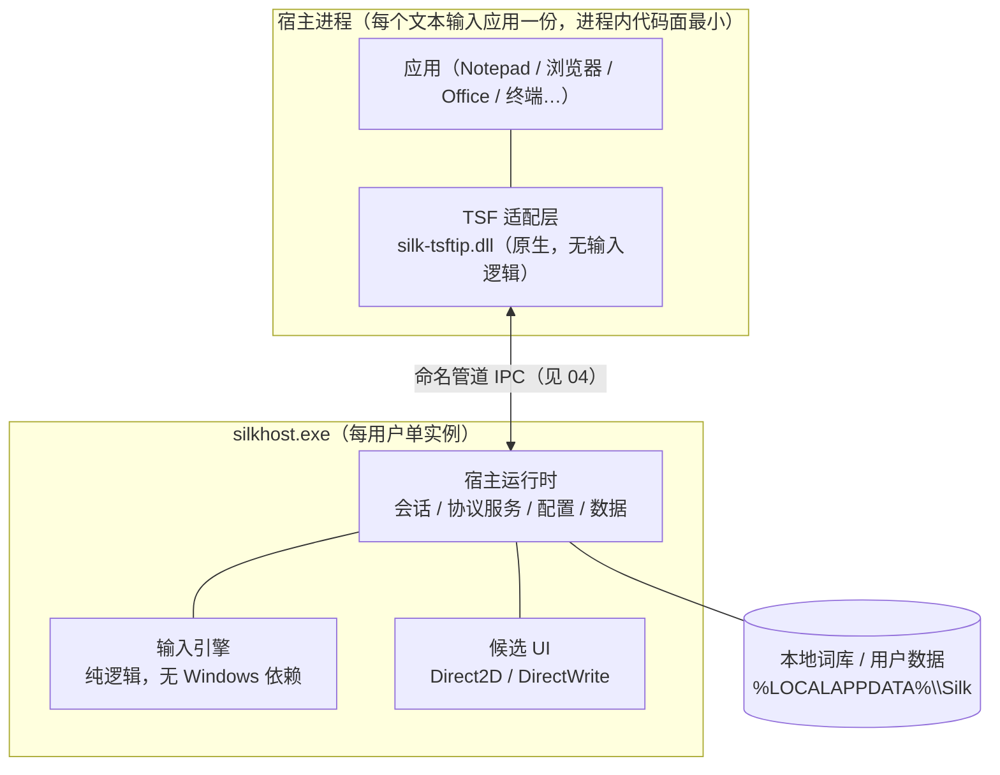

# 02 总体架构

本文是 Silk IME 软件基座的架构主干：定义分层、进程模型、模块分解与关键决策。问题与需求见 [01](01-problem-and-requirements.md)，各层细节见 03–08。

## 设计立场

产品原则（README）到架构原则的映射：

| 产品原则 | 架构落点 |
| --- | --- |
| 基础输入可靠稳定 | 进程内代码面最小化；任何故障可降级且不丢按键 |
| 极简，但恰到好处 | 基座只做输入热路径 + 候选 UI + 安装注册；其余只留缝 |
| 前沿技术加持 | 引擎内部预留排序/个性化接缝（见 05），基座不实现 |
| 本地优先，数据可控 | 无网络依赖；全部数据在本机目录，格式可迁移 |

## 分层视图

三条硬性依赖规则：

1. **引擎不依赖任何 Windows API**：纯 Go 包，可在任意平台单测。
2. **只有 `silk-tsftip.dll` 知道 TSF**：宿主运行时与引擎对 COM/TSF 零感知。
3. **只有 UI 模块知道 Direct2D/DirectWrite**：渲染细节不出模块接口。

## 进程模型

两个可执行产物（外加一个渲染库 `silkui.dll`），一条 IPC 线：

| 产物 | 语言 | 体量目标 | 职责 | 不做什么 |
| --- | --- | --- | --- | --- |
| `silk-tsftip.dll` | Rust | 数百 KB，每宿主进程一份 | TSF 注册/激活、按键拦截、composition 维护、插入点度量、协议客户端 | 输入逻辑、词库、网络、渲染实现（兜底路仅按需加载 `silkui.dll`） |
| `silkhost.exe` | Go | 单实例 | 会话管理、输入引擎、候选渲染、配置与词库、协议服务 | 与 TSF/COM 交互 |

为什么不是单进程（DLL 内含引擎）：

- TSF DLL 会被加载进**每个**有文本输入的进程。引擎 + 运行时放进程内意味着每个应用都背一份词库与逻辑，内存与故障面按进程数放大。
- Go 运行时不进宿主进程：`buildmode=c-shared` 在 DllMain/运行时初始化上有长期缺陷史，且每进程一份 Go 运行时不可接受。
- 引擎升级、词库更新、崩溃恢复都要求逻辑在**一个**可独立重启的进程里。行业先例一致：Keyman（`kmtip` ↔ `Keyman.exe`）、青简（`qingjian_tsf.dll` ↔ `qingjian-server`）、小狼毫（`weasel.dll` ↔ `WeaselServer`）。

为什么不是三进程（引擎/UI 分离）：候选渲染与引擎同进程可省一次 IPC 往返，UI 崩溃可用引擎状态重建会话；进程数量每加一个，安装、升级、诊断成本都上升。基座先取两进程，UI 模块保留独立成进程的接缝（模块接口不变，见 06）。

## 模块分解

以深模块（deep module）标准划分：接口小、行为多、接缝清晰。

| 模块 | 所在 | 接口（调用方须知） | 深度来源 |
| --- | --- | --- | --- |
| 引擎 `engine` | host | `NewSession` / `Session.Handle(Event) → Response` / `Session.Close`，其余全部是内部结构 | 分词、查词、排序、分页、用户词频全部藏在一次 `Handle` 之后 |
| 会话运行时 `session` | host | 焦点进入/离开、事件路由、超时与合并 | 并发模型（每会话单 goroutine 串行化）对调用方不可见 |
| 协议 `ipc` | host + shim 各一份编解码 | 帧格式 + 消息目录（04），版本协商 | 传输细节（管道、重连、背压）藏在接口后 |
| 候选渲染 `silkui` | Rust 渲染库（独立 DLL，C ABI）：host 常驻加载，shim 兜底按需加载 | `Show(CandidateView)` / `Move(Rect)` / `Hide()` | Direct2D/DirectWrite、DPI、主题、层级、可见性规则全在库内 |
| TSF 适配 `tsftip` | shim | 对 OS 暴露 COM 对象；对 host 暴露协议客户端 | TSF 生命周期、edit session、注册表细节全在 DLL 内 |
| 安装注册 `install` | 安装器 + shim 导出 | `SilkRegister(scope)` / `SilkUnregister(scope)` | 注册表布局与 COM 注册调用收敛在一处 |

## 关键决策记录

### ADR-1 进程拆分：薄 DLL + 每用户单实例 host

决策：TSF DLL 只做适配，输入逻辑集中在 `silkhost.exe`。
备选：DLL 内含引擎（否决：每进程内存/故障面放大）；系统服务（否决：Session 0 隔离与提权复杂度，收益为零）。
后果：引入 IPC 与降级路径（04）；换来引擎可测、可独立升级、可崩溃重启。

### ADR-2 shim 使用 Rust + windows-rs

决策：`silk-tsftip.dll` 用 Rust 编写，COM 经 `windows-rs` 实现。
备选：C++（MSVC + SDK 示例最全，但进程内内存安全靠自觉）；Go（运行时不进宿主，否决）。
理由：这是唯一进入所有应用进程的代码，内存安全是可靠性的一等公民；`windows-rs` 对 TSF COM 接口（`ITfTextInputProcessor_Impl` 等）有完整绑定，且有成品先例（khiin-rs；0c 亦为 Rust TSF + Go 引擎）。
后果：工具链增加 Rust；CI 需 MSVC + cargo 矩阵（08）；构建必须静态 CRT（`+crt-static`），不依赖 VC++ 运行库——缺运行库是竞品头号安装故障。

### ADR-3 候选 UI：渲染实现一份，部署两路

决策：候选窗渲染收敛为独立渲染库 `silkui`（Rust，Direct2D/DirectWrite；主路 flip 交换链 + DWM 合成，兜底 `UpdateLayeredWindow`），以独立 DLL（C ABI）交付。默认由 `silkhost.exe` 动态加载、进程外绘窗；当进程外窗口被系统 UI（开始菜单、搜索面板）遮挡时，切换宿主内渲染通道——TSF DLL 按需加载同一 `silkui.dll`（绝对路径），在宿主进程内就地绘窗（`host_render`）。
备选：只在 server 进程绘窗（青简/XSIME 的开始菜单遮挡是已知问题，需要 UIAccess 才能盖过系统 UI）；只在宿主内绘窗（小狼毫的绘制崩溃史：图形栈代码进入所有进程）；独立 UI 进程（多一个产物，收益为零）。
理由：竞品证据表明两种单路径都有真实缺陷，双路渲染是产品级要求而非可延后优化；Weasel 2018 年的架构权衡记录（issue #110：进程外换宿主稳定、"兼容性風險++"）及其后八年逐项兑现的 z-order/坐标/生命周期 issue，是这笔交易的一手依据。渲染实现只有一份，两条部署路的视觉与行为天然一致，测试面不翻倍。
后果：两路共用同一二进制，渲染实现真正单份；Go 侧纯 `LoadLibrary` 调用、免 cgo；shim 仅兜底场景加载渲染库，常驻进程内面最小（以 Rust 内存安全 + 严格输入校验兜底）；`silkui` 接口仅 `Show/Move/Hide` + 视图结构，FFI 面极小（06）。

### ADR-4 IPC：命名管道 + 长度前缀 JSON 封套

决策：`\\.\pipe\silk-ime-<SID>`，消息模式，帧 = `u32 LE 长度 + JSON 封套 {v,id,type,payload}`。
备选：共享内存环（复杂，先不需要）；gRPC/COM（重）；裸结构体二进制（跨语言演进脆弱）。
理由：命名管道天然支持 per-用户 ACL 与消息边界；JSON 在双方（Go/Rust）都是零成本依赖，按预算（04）其编解码开销 < 0.1 ms，不是瓶颈。
后果：`ponytail:` 体积/编码开销是已知上限；若剖析显示协议占比 > 热路径预算 10%，升级为二进制编码，消息目录不变。

### ADR-5 host 懒启动 + 空闲自退出

决策：DLL 首次连接失败时拉起 `silkhost.exe`；host 无会话超过空闲阈值后自行退出。
备选：登录自启常驻（违背“安静”）；安装为服务（否决）。
后果：首次冷启动多 50–150 ms（可接受，见 08 预算）；零后台驻留成本。

### ADR-6 注册由 shim 导出函数完成

决策：DLL 导出 `SilkRegister` / `SilkUnregister`（支持 per-user / per-machine 作用域），安装器调用；注册逻辑走 `ITfInputProcessorProfiles` 与 `ITfCategoryMgr` API。
备选：安装器直接写注册表（脆）；`DllRegisterServer` + regsvr32（无法传作用域参数）。
后果：注册代码与 TIP 代码同库，注册表布局只有一处定义（07）。

### ADR-7 词库：预编译只读资产 + 纯文本用户数据

决策：核心词库构建期编译为紧凑二进制（启动 mmap，发布物只读）；用户词频与自定义词存纯文本（UTF-8），内存改写、原子落盘，整目录可复制迁移、可手改。
备选：SQLite（查询层不划算，且用户不可读）；二进制追加日志（不可手改、迁移性差，放弃）。
理由：竞品调研核心结论——用户要开箱结果与可迁移数据；清风"纯文本整目录迁移"是正面样板，水杉卸载删用户词库是反面教材。
后果：核心词库格式带版本号与迁移函数；用户数据文本格式在文档固化（05）。

### ADR-8 降级原则：任何故障不丢按键

决策：host 超时/不可用时，DLL 将按键按原样放行（英文直通），并限速重启 host。
备选：吞掉按键等恢复（用户视角=输入法卡死，最差选择）。
后果：极端情况下退化为“英文键盘”，永不卡输入（08 降级矩阵）。

## 演进方向（只留缝，不实现）

- **多输入方案**（双拼/五笔）：引擎的方案描述器位置预留，接口不暴露具体方案。
- **个性化与端侧学习**：排序器（Ranker）接缝，未来承载持续学习/热词注入（见 [../design/tech-survey.md](../tech-survey.md)）。
- **设置 UI / 托盘**：基座以文本配置 + 词库文件服务高级用户；图形设置是独立应用，不进热路径。
- **自动更新**：安装器保留静默安装参数与文件布局约定，更新器后续独立。

## 需求映射

| 决策 | 覆盖需求 |
| --- | --- |
| ADR-1/2 | R-5 引擎平台分离、R-7 故障降级、R-11 性能 |
| ADR-3 | R-4 候选 UI |
| ADR-4 | R-2 热路径、R-7、R-10 可诊断 |
| ADR-5/6/7 | R-6 安装、R-8 本地数据、R-9 配置词库 |
| ADR-8 | R-7 |
