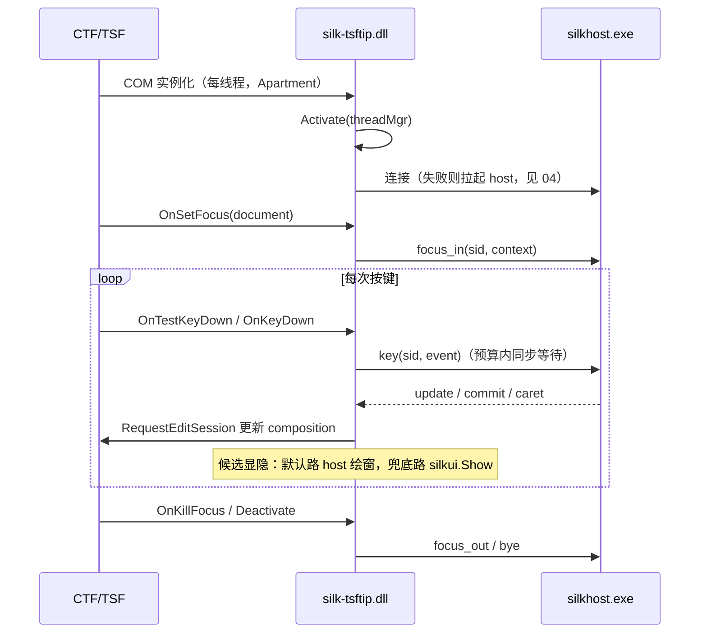
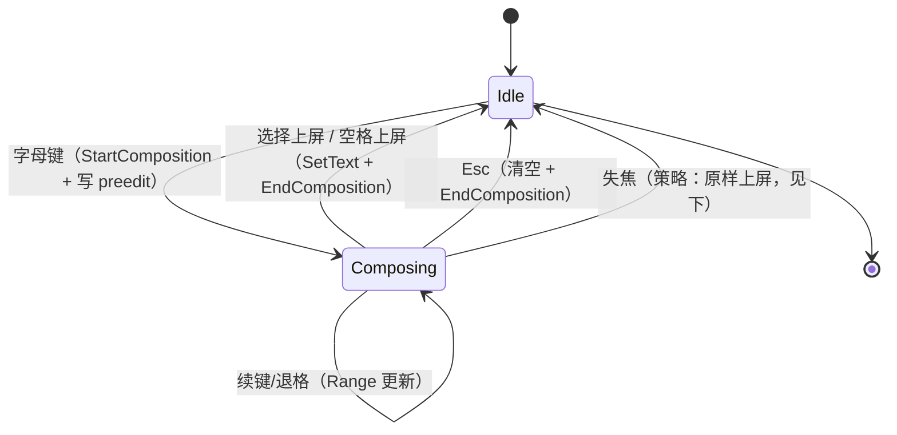

# 03 Windows 平台适配层（TSF）

本文定义 `silk-tsftip.dll` 的职责边界、注册机制、生命周期与宿主兼容性策略。总体架构见 [02](02-architecture.md)，协议细节见 [04](04-process-and-ipc.md)。

## 平台事实

设计先接受平台给定的事实，再谈方案：

1. **TSF 是唯一路径**。Windows 输入 API 只有 IMM32（遗留）与 TSF 两套；微软官方已明确"系统会阻止通过 IMM32 实现的 IME"，所有新输入法必须以 TSF TIP（Text Input Processor）实现。
2. **TIP 被加载进每个文本输入宿主进程**。CTF 子系统按需在应用进程内以 COM in-proc server 方式实例化 TIP——这是"进程内代码面最小化"（ADR-1）的根因。
3. **传统 IMM 应用由系统桥接**（CUAS）。遗留 IMM32 应用通过系统自带桥使用 TSF 输入法，我们不实现 IMM 层。
4. **触摸键盘也承载 TSF IME**，与 IME 用约定的 PUA 字符交互（翻页等），触屏场景自动受益，无需单独实现。
5. **注册是 COM 注册 + TSF 注册两步**（微软官方注册文档）：标准 in-proc server 注册表项，外加 `ITfInputProcessorProfiles` 与 `ITfCategoryMgr` 的 TSF 专属注册。

## 职责边界

| 做 | 不做 |
| --- | --- |
| COM/TSF 对象实现与注册导出 | 输入逻辑、分词、查词、排序 |
| 按键拦截与语义翻译（VK → 协议键事件） | 词库读写 |
| composition 的创建/更新/提交（TSF 要求进程内完成） | 候选内容生成 |
| 插入点度量（`ITfContextView::GetTextExt`） | 默认态的候选绘制（仅 `host_render` 兜底通道） |
| 协议客户端（连接、请求、超时、降级） | 网络、脚本运行时、任何动态代码 |

"不含输入逻辑"用 crate 边界强制：`tsftip` crate 只依赖 `protocol` 与 `silkui`（兜底渲染），不依赖任何引擎 crate（竞品青简的同名约束）。

## 注册与激活

### 注册内容

| 步骤 | 机制 | 写入位置 |
| --- | --- | --- |
| COM in-proc server | CLSID、`InprocServer32`、`ThreadingModel=Apartment` | `HKLM\Software\Classes\CLSID\…`（机器级） |
| TIP 注册 | `ITfInputProcessorProfileMgr::RegisterProfile`（语言 `0x0804`，profile GUID，名称/图标，`bEnabledByDefault=false`） | `…\Microsoft\CTF\TIP\{CLSID}\LanguageProfile\0x0804\{ProfileGUID}`（HKLM） |
| 类别注册 | `ITfCategoryMgr::RegisterCategory`（`GUID_TFCAT_TIP_KEYBOARD` + 五类 TIPCAP） | `…\CTF\TIP\{CLSID}\Category\…`（HKLM） |
| 用户启用 | `ITfInputProcessorProfiles::EnableLanguageProfile` | `…\LanguageProfile\…\Enable`（HKCU） |
| 用户语言列表 | 直接写 `Control Panel\International\User Profile\zh-Hans-CN` 的 `0804:<CLSID><Profile>` 值（序号 1..N 连续，空洞会让 InputSwitch.dll 崩） | HKCU |

### 作用域

- **机器级（必须提权）**：COM + TIP + 类别三件套写 HKLM。这组 API 非提权一律 `E_FAIL`，且平台**不存在**"按用户注册键盘 TIP"的形态（调研 [windows-ime-registration-2026.md](../../research/windows-ime-registration-2026.md) §1.3；Weasel/PIME/青简/清风/Mozc 全部提权注册）。任何失败必须显式报错，禁止吞 HRESULT。
- **用户级（普通权限）**：`Enable` 位 + 用户语言列表 + `InstallPath`。用户语言列表成员资格决定 Win+空格 可见性；只写它不写机器级会产出「看得见、激活失败」的幽灵条目（调研 §3）。

### 导出接口（ADR-6）

```
SilkRegister(machine)  // 机器级三件套，提权运行；幂等
SilkRegister(user)     // 用户级：Enable + 用户语言列表 + InstallPath；幂等
SilkUnregister(scope)  // 与注册对称清理（含用户语言列表序号重排）；幂等
SilkRegisterSelf()     // = SilkRegister(user)，供安装器提升后以原用户身份补登记
```

注册结果写 `%LOCALAPPDATA%\Silk\logs\silkreg.log`，失败另弹提示框（rundll32 无控制台，静默失败在真机排查中代价极高）。安装器流程：提升注册机器级 → 以**原始用户身份**跑 `SilkRegisterSelf`（竞品踩过的坑：提升上下文注册到了管理员账户）。

### 激活感知

实现 `ITfInputProcessorProfileActivationSink` 感知用户切换；TIP 激活本身由 TSF 调 `Activate` 完成，无需我们抢控制权。

## 生命周期与线程模型



要点：

- **每线程一个 TIP 实例**，实例数 = 活跃文本线程数。实例内状态无共享；跨线程共享状态只存在于 host（会话运行时负责并发模型）。
- **TSF 回调里禁止长阻塞**。所有对 host 的请求有硬超时（默认 30 ms，见 04）；edit session 只做 composition 文本更新，不做业务计算。
- **窗口切换是竞态高发区**（小狼毫"切换/新建窗口时多线程崩溃"的教训）。焦点、文档、会话三者的状态迁移在 shim 内串行化到单一状态机，任何 TSF 回调只投递事件，不直接改共享状态。
- **初始化时机**：D3D/DXGI 工厂与设备不得在 `DllMain` 中创建/释放（DXGI 官方约束）；渲染栈初始化延后到 `ActivateEx`/首次绘窗。

## 按键处理与 composition

### 按键决策

`OnTestKeyDown` 依据**本地缓存的模式状态**（中/英、全/半）决定是否拦截：中文模式下字母/数字/编辑键进引擎路径，其余（Ctrl 组合等）放行。英文模式下字母键仍进引擎做单词补全（可配置关闭）；补全关闭或降级形态为纯直通、零 IPC。模式状态以 host 为权威、shim 缓存最终副本（模式切换本身走一次请求）。

### composition 生命周期



- composition 通过 `ITfInsertAtSelection` + `StartComposition` 建立，preedit 下划线样式用 `GUID_PROP_ATTRIBUTE`。
- 失焦处置策略：**原样上屏已输入字符**（不丢用户输入，与主流 IME 一致）；配置可改为"丢弃"。
- 候选窗由 `silkui` 自绘，但**必须**经 `ITfUIElementMgr::BeginUIElement` 登记（候选列表实现 `ITfCandidateListUIElement`）：这是系统 light dismiss、全屏/游戏抑制、触摸键盘策略的接入点（官方 UIless 模式要求）；语言栏/托盘入口后置。

## 宿主兼容性矩阵

| 宿主类别 | 示例 | 主要风险 | 验证层级 |
| --- | --- | --- | --- |
| Win32 / GDI | 记事本、资源管理器地址栏 | 低，基准 | 自动化 + 手测 |
| DirectWrite 浏览器 | Chrome / Edge / Firefox | `GetTextExt` 语义、页面内嵌编辑器 | 手测清单 |
| 办公套件 | Word / WPS | selection 语义复杂、组合期重排 | 手测清单 |
| 终端 | Windows Terminal / conhost | 光标定位、快速连续输入 | 自动化 + 手测 |
| WinUI / UWP / XAML | 系统设置、Store 应用 | 焦点与坐标语义、悬浮键盘 | 手测清单 |
| 提权进程 | 管理员记事本 | 完整性级别：host 服务需可被高完整性进程连接 | 手测 |
| 远程桌面 | RDP 会话 | 延迟放大、剪贴板/焦点切换 | 手测 |
| 系统 UI | 开始菜单、搜索面板 | z-order：进程外候选窗可能被遮挡 → `host_render` 兜底（06） | 手测 |
| 全屏/游戏 | 反作弊游戏 | **明确不支持**：反作弊拒载第三方 IME | 文档声明 |
| 触摸键盘 | 系统触屏键盘 | PUA 按键约定、布局切换 | 手测 |

## 多架构支持

- 发布 x64 与 arm64 两个构建；x64 模拟进程加载 x64 DLL，arm64 原生进程加载 arm64 DLL。
- **Arm64X 合并包**（单一 DLL 同时服务 x64/arm64 进程）是优化项：MSVC 支持，Rust 工具链支持度待验证（开放项 O-1）。
- host（Go）：x64 与 arm64 原生构建；Go 静态链接，无运行库依赖。

## 开放验证项（M0 spike 清单）

| ID | 事项 | 验证方法 |
| --- | --- | --- |
| O-1 | Rust 产出 Arm64X DLL 的工具链可行性 | 最小 TIP 探针在 x64/arm64 宿主加载 |
| O-2 | ~~per-user 注册在 Win10 21H2+ / Win11 的行为一致性~~ | 已结论：平台无 per-user 键盘 TIP 注册，配方见 [注册调研](../../research/windows-ime-registration-2026.md) |
| O-3 | `GetTextExt` 在 WinUI/终端的坐标语义 | 探针记录坐标与实际插入点偏差 |
| O-4 | ~~高完整性宿主连中完整性 host 管道~~ | 已修：管道 SD 加 `S:(ML;;NW;;;ME)` 中完整性标签（真机复现过跨 IL Access denied） |
| O-5 | DLL 占用下的升级替换策略（07） | 安装器脚本在开 N 个应用时升级 |

## 需求映射

覆盖 R-1（注册/激活/卸载）、R-2（热路径拦截）、R-3（中英文输入面）、R-5（平台分离）、R-12（多架构）、R-13（兼容矩阵）。
