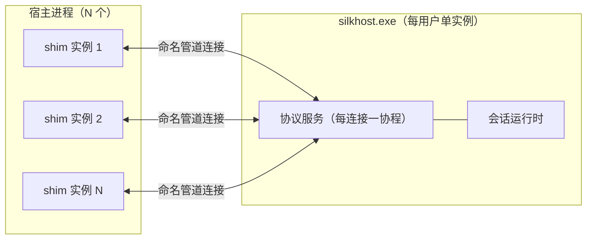
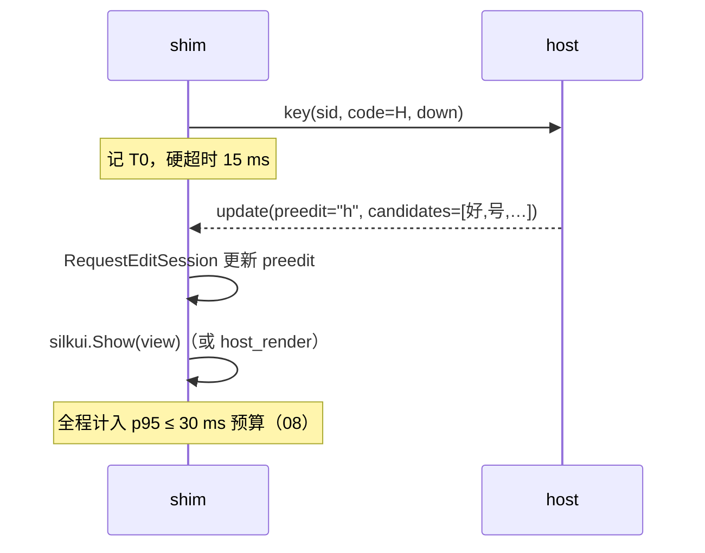
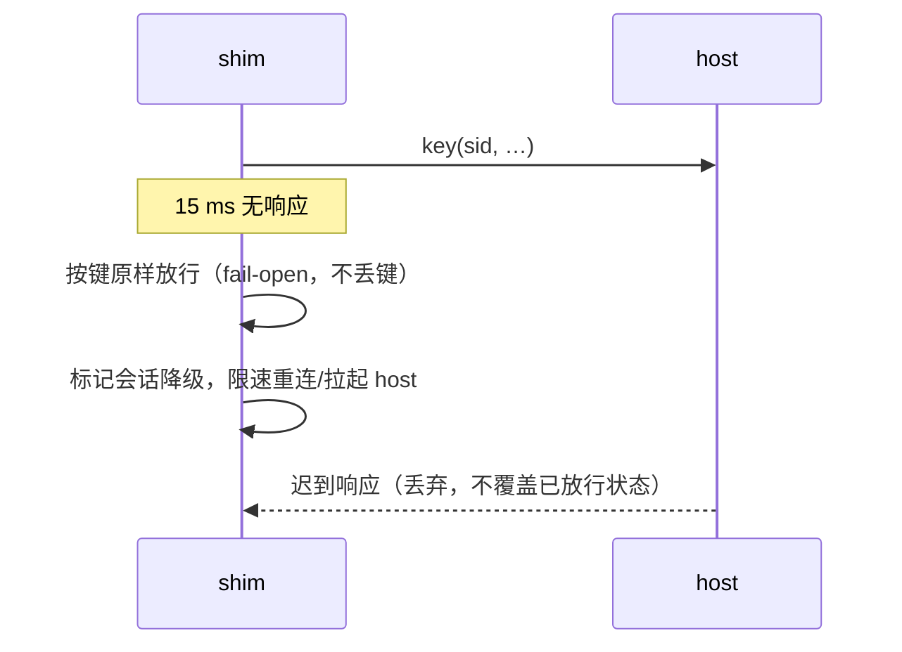

# 04 进程模型与 IPC 协议

本文定义 `silk-tsftip.dll` 与 `silkhost.exe` 之间的拓扑、协议与故障语义。架构决策见 [02](02-architecture.md) ADR-1/4/5/8。

## 目标 / 非目标

- 目标：按键级低延迟、不丢键、可降级、可版本演进、per-用户隔离。
- 非目标：跨机通信、多用户共享、通用 RPC 框架、流式大数据传输。

## 拓扑



- 管道名 `\\.\pipe\silk-ime-<用户 SID>`，**一个用户一个 host 实例**；SID 入名避免会话/用户串扰。
- 单实例由管道独占 + 全局互斥双重保证；第二个 host 启动即退出。
- shim 实例无状态于彼此；一切跨进程共享状态（词频、模式、配置）在 host。

## 传输层：命名管道

选型理由：消息边界天然、内核级 per-用户 ACL、先例一致（青简 `\\.\pipe\qingjian`、WeaselIPC 同构）。

- 模式：字节模式 + 长度前缀自定界（集成实测：消息模式管道按写分消息，会劈开帧边界；长度前缀已自定界，消息模式冗余）；shim 侧单 IO 线程，host 侧每连接一个读循环。
- `PIPE_REJECT_REMOTE_CLIENTS`：拒绝远程客户端。
- 连接是长连接：TIP 实例生命周期内复用；断开由上层负责重连（见故障语义）。

## 帧与封套

```
帧 = u32 LE 长度（上限 1 MiB）+ UTF-8 JSON
封套 = { "v": 1, "id": 42, "type": "key", "sid": "s-7f3a", "payload": { ... } }
```

| 字段 | 含义 |
| --- | --- |
| `v` | 协议版本；不匹配则拒绝连接并降级 |
| `id` | 请求-响应关联号；下行主动事件为 0 |
| `type` | 消息类型（下表） |
| `sid` | 会话 ID，焦点进入时由 host 分配 |
| `payload` | 类型专属载荷 |

`ponytail:` JSON 编解码在预算内（< 0.1 ms/往返），换取两端零代码生成依赖；若剖析显示协议开销超热路径预算 10%，封套字段不变、编码换二进制。

## 消息目录

| type | 方向 | 语义 | 载荷要点 |
| --- | --- | --- | --- |
| `hello` | shim→host | 首连接：版本、能力位、TIP 构建号 | `v, caps, build` |
| `welcome` | host→shim | 版本协商结果、全局配置快照（模式默认值等） | `v, cfg` |
| `focus_in` | shim→host | 焦点进入文档 | `app, hwnd, lang_hint` |
| `focus_out` | shim→host | 焦点离开 | `sid` |
| `key` | shim→host | 语义键事件 | `code, rune?, down, mods, ts` |
| `action` | shim→host | 选择/翻页/模式切换/取消 | `kind, index?（select/page）, mode?={chinese, full_punct}（toggle）` |
| `update` | host→shim | 状态更新：preedit、候选、模式 | `preedit, caret, candidates[], page_index, mode={chinese, full_punct}` |
| `commit` | host→shim | 上屏文本 | `text` |
| `caret` | shim→host | 插入点屏幕坐标（候选窗锚点） | `rect{x,y,w,h}`（随 update 按需发） |
| `show` / `hide` | host→shim | 候选窗显隐（用于 host_render 兜底通道） | `view?` |
| `ping` / `pong` | 双向 | 存活探测（空闲期 30 s） | `ts` |
| `error` | host→shim | 请求失败 | `id, code, msg` |
| `bye` | shim→host | 会话结束/进程退出 | `sid` |

`update` 与 `commit` 允许同帧先后到达：shim 保证按序应用（先更新后提交）。

## 时序：按键往返（热路径）



超时分支：



迟到响应一律丢弃：**响应携带的按键序号已过期时不得回写 composition**，避免状态错位。

## 懒启动与自恢复（ADR-5/8）

1. shim 连接失败 → 从注册表 `InstallPath` 读 host 路径 → `CreateProcess` 拉起 → 等待 `hello` 就绪（上限 2 s）。
2. host 空闲（无会话）超过 15 min 自行退出，退出前原子落盘用户数据。
3. host 异常退出：shim 限速重启（≤ 3 次/分钟），连续失败后本进程转纯直通（英文键盘），并通过 `error` 计数供诊断（08）导出。
4. 任何路径下，**按键永远先于状态**：拿不准就放行，绝不吞键。

## 背压与合并

- 每会话单飞行请求：上一键未回应时新键事件覆盖旧请求（连打场景天然合并），`id` 递增使旧响应可判过期。
- 渲染指令合并：同一帧内 `caret`+`update` 合并为一次窗口移动+重绘；连续翻页只渲染最后一帧。
- host 侧会话串行化（每会话单 goroutine），无锁；队列深度告警阈值 > 8。

## 安全

| 威胁 | 对策 |
| --- | --- |
| 非本用户进程接入 | 管道 DACL = 当前用户 SID；拒绝远程客户端 |
| 畸形帧攻击 host | 长度上限、字段白名单、解码器 fuzz 测试（08） |
| 插件式任意代码执行 | **不内嵌任何脚本/插件运行时**（PIME 内嵌运行时的 CVE/RCE 账单是反面教材） |
| 隐私外泄 | 协议字段不含宿主窗口文本；`focus_in` 只带进程名（诊断用，可关） |

## 版本与演进

- `v` 当前为 1；host 兼容 N-1（旧 shim 连新 host 可用），shim 连旧 host 拒绝并降级。
- 消息增删只做加法；删除字段先标记废弃两个小版本。
- 编码升级条件见帧格式节的 `ponytail:` 注记。

## 需求映射

覆盖 R-2（热路径延迟）、R-7（不丢键降级）、R-8（本地数据/隐私）、R-10（可诊断）、R-11（性能预算）。
