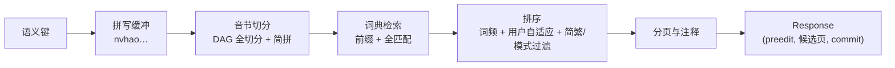
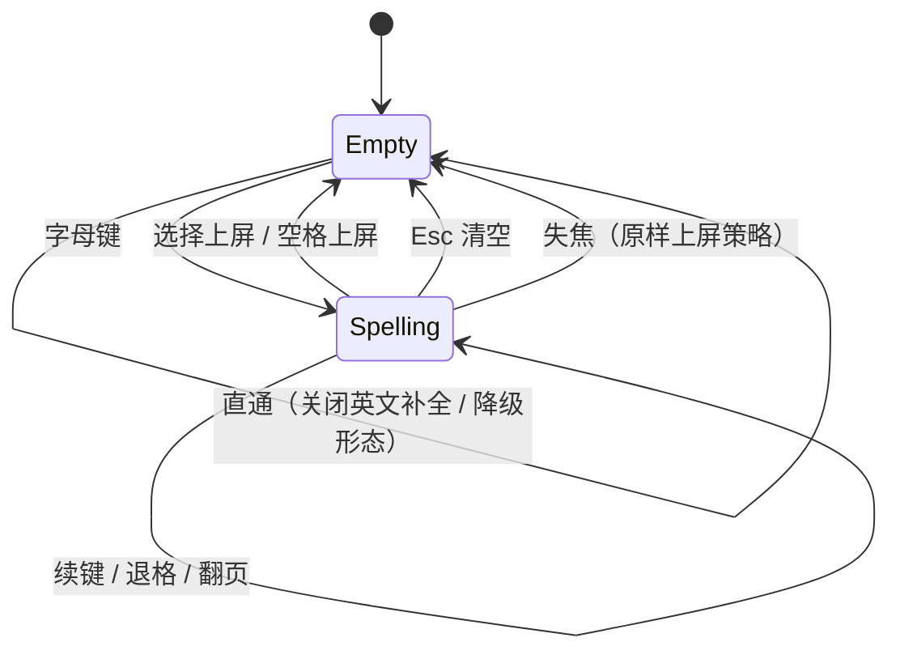

# 05 输入引擎

本文定义输入引擎的接口、流水线、数据与性能约束。引擎是纯 Go 逻辑，无 Windows 依赖（ADR-1 依赖规则），进程归属与协议见 [04](04-process-and-ipc.md)。

## 职责 / 非职责

| 做 | 不做 |
| --- | --- |
| 按键流 → preedit / 候选 / 上屏文本 | 文件与网络 I/O（数据由运行时喂入/取走） |
| 拼音分词、查词、排序、分页 | 窗口、渲染、坐标 |
| 模式状态（中/英、全/半、简/繁开关位） | TSF/COM 概念 |
| 用户词频与自定义短语的**内存态**与增量输出 | 用户数据持久化（运行时职责） |

## 接口

深模块设计：调用方只见会话与一次 `Handle`，其余全部是实现细节。

```go
// engine 包对外的全部接口
type Event struct {
    Key     *Key      // 语义键：Code/Down/Mods
    Select  *int      // 选第 n 个候选
    Page    *int      // 翻页 ±1
    Toggle  *Mode     // 模式切换
    FocusOut bool     // 失焦处置
}

type Response struct {
    Consume    bool        // 该事件是否被 IME 消化
    Preedit    string      // 组字串（空 = 无组合）
    Caret      int         // preedit 内光标位置（rune）
    Candidates []Candidate // 当前页候选
    PageIndex  int
    Commit     string      // 本事件应上屏的文本（空 = 无）
    Mode       Mode        // 当前模式快照
}

func Open(data []byte, user UserState, cfg Config) (*Engine, error) // data = mmap 词库字节
func (e *Engine) NewSession(ctx SessionMeta) *Session
func (s *Session) Handle(ev Event) Response      // 纯函数式：给定状态与事件 → 响应
func (s *Session) Close()
func (e *Engine) DrainUserDelta() []UserEntry    // 运行时定时取走增量，落纯文本
```

契约要点：

- `Handle` 确定性：同状态同事件必得同响应，无全局随机、无时钟依赖（时间戳由事件携带）。测试与调用方跨同一接缝。
- `Handle` 热路径零文件 I/O、每次调用分配预算 ≤ 2 个小对象。
- 并发：`Session` 非并发安全，由会话运行时保证单 goroutine 串行调用；`Engine` 可多会话共享（只读词库 + 用户态经内部同步）。

## 处理流水线



- **音节切分**：全拼 DAG 切分 + 简拼路径；模糊音（z/zh 等）在切分层做等价扩展，不做二次查询。
- **整句转换**：候选即短语/句子级（词典含多字词），后续接续键做贪心最长匹配 + 回退；v1 不做全局最优解码（留缝：解码器接口在实现内部，可替换为图搜索/神经重排）。
- **英文输入**：与中文共用流水线——切分器换词边界切分、词典换英文词典、排序器同一接口；v1 提供单词补全，不做拼写纠错。
- **上屏语义**：数字键=选候选上屏；空格=首选上屏；标点=智能标点替换后上屏（成对标点维护配对栈）。

## 状态机（引擎内视角）



与 [03](03-windows-platform.md) 的 composition 状态机是同一件事的两端视角：TSF 侧管"系统组合区"，引擎侧管"拼写缓冲"；shim 保证两侧转移一一对应。

## 数据

### 核心词库（发布物，只读）

- 构建期编译为紧凑二进制：`magic + version + 段偏移表`（拼音索引、词条表、词频表）。
- 运行时 `mmap` 只读映射，零解析拷贝；格式带版本号，升级走迁移函数。
- 体量参考：覆盖 GB 18030 常用范围的全拼词库目标 < 30 MB 文件、工作集增量 < 10 MB。

### 用户数据（纯文本，可迁移）

| 文件 | 格式 | 说明 |
| --- | --- | --- |
| `userdict.txt` | `词<TAB>拼音<TAB>频次<TAB>时间戳` | 用户词频，原子落盘（写临时文件 + rename） |
| `phrases.txt` | `短语<TAB>触发码` | 自定义短语，用户可直接编辑 |
| `silk.toml` | TOML | 配置；人类可编辑是产品需求，引入唯一解析依赖 |

整目录可复制迁移；卸载默认保留（产品红线，见 [08](08-reliability-and-testing.md)）。

## 排序与个性化（演进缝）

`排序器`是引擎内部接口，v1 唯一实现 = 词频 + 用户自适应 + 模式过滤。接口形状按以下证据预留，**基座不实现**：

- 本地小模型只做候选重排、不做生成，已有量化先例：4.5 MB / 425 万参数模型每按键 0.33 ms/字，评测首选正确率 41→52；0c 的本机 Transformer 重排 P95 7–16 ms。
- 形状约束：重排器输入 = 候选特征 + 上下文向量，输出 = 置换；同步预算 2 ms、异步预算 50 ms（停顿时补排，不进按键同步路径）。
- 热词注入、联邦评测等时效性能力同样挂在排序器接缝（参见 [../tech-survey.md](../tech-survey.md)）。

## 性能预算

| 指标 | 预算 | 测量 |
| --- | --- | --- |
| `Handle` 首屏 10 候选 | p95 ≤ 5 ms，p99 ≤ 10 ms | `go test -bench` 语料基准 |
| 按键到候选显示（端到端） | p95 ≤ 30 ms | 集成测量（08） |
| 热路径分配 | ≤ 2 allocs/op | `testing.AllocsPerRun` 门禁 |
| 引擎堆内存（不含 mmap） | ≤ 30 MB | 启动后稳态采样 |
| 冷启动到首个候选 | ≤ 150 ms（含 host 冷启动） | 安装后首用计时 |

## 测试策略

- **黄金用例**：`输入串 → 期望 preedit/候选/commit` 三元组语料库（≥ 500 条，含简拼、模糊音、整句、标点、英文补全、中英混输边界）；任何改动全量回归。
- **确定性测试**：同输入重放两次断言逐字节相等。
- **模糊测试**：分词器与缓冲处理吃随机 rune 流，断言不 panic、不越界、缓冲有界。
- **性能门禁**：基准跑 CI，退化 > 20% 报警。

## 需求映射

覆盖 R-2（热路径）、R-3（中英文输入面）、R-8（本地数据）、R-9（配置词库）、R-11（性能）、R-14（演进缝）。
