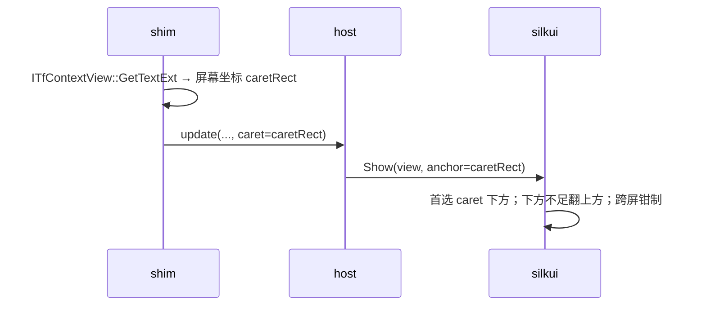
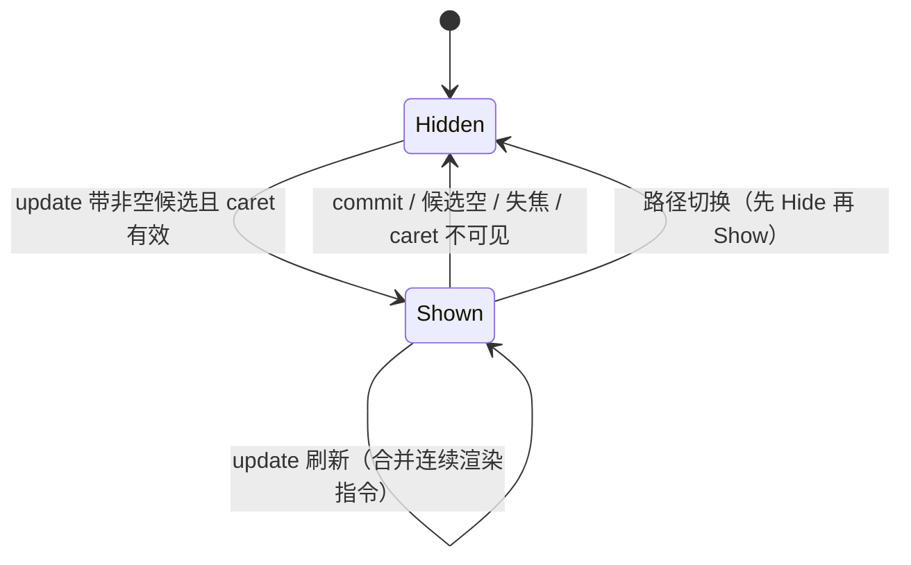

# 06 UI（候选窗）

本文定义候选窗的归属、定位、渲染与可见性规则。渲染库 `silkui` 的双路部署决策见 [02](02-architecture.md) ADR-3。

## 职责范围

基座 UI 只做**候选窗**。设置界面、托盘、皮肤都是后续独立应用；基座以文本配置服务高级用户（产品原则"极简"）。

## 部署双路（ADR-3）

| 路径 | 渲染位置 | 触发 | 约束 |
| --- | --- | --- | --- |
| 默认路 | `silkhost.exe` 经 FFI 加载 `silkui` 绘窗（进程外） | 常规宿主 | 窗口需置顶；被系统 UI 遮挡是已知场景 |
| 兜底路 `host_render` | TSF DLL 按需加载同一 `silkui.dll`（绝对路径），宿主进程内就地绘窗 | 前台为开始菜单/搜索面板等系统 UI 时（启发式检测 + 用户开关） | 进程内图形面扩大；Rust + 严格输入校验兜底 |

- 渲染实现**只有一份**（`silkui` crate，独立 DLL / C ABI）：输入 = `CandidateView` + `WindowParams`，负责建窗、布局、绘制、显隐。两路的视觉与行为天然一致；Go 侧动态加载、免 cgo。
- 触发切换时先 `Hide` 再换路 `Show`，避免双窗同框；切换决策记入日志（08）。
- 备选方案（UIAccess 让进程外窗口盖过系统 UI）需要签名 + uiAccess 清单 + 受信任目录（即强制 Program Files 安装），作为 per-machine "完整模式"的可选增强，不作为基座前提（07）。

## 窗口形态

- 样式：`WS_EX_NOACTIVATE | WS_EX_TOOLWINDOW` 独立 popup（非分层），`SetWindowPos` 置顶带；永不抢键盘焦点（`WM_MOUSEACTIVATE` 返回 `MA_NOACTIVATE`）。
- **owned window**（官方要求）：窗口所有者取 `ITfContextView::GetWnd`（失败回退 `GetFocus`）。
- **light dismiss**（官方要求）：显隐时 `NotifyWinEvent(EVENT_OBJECT_IME_SHOW/HIDE/CHANGE)`，参与系统轻量关闭；不做 sticky 窗。
- 交互：鼠标点击 = 选候选；滚轮 = 翻页。键盘路径（数字选择、翻页键）全在 shim 侧，不依赖窗口焦点。
- 外观：圆角/阴影/深色边框全部走 DWM（`DWMWA_WINDOW_CORNER_PREFERENCE = DWMWCP_ROUNDSMALL`、`DWMWA_USE_IMMERSIVE_DARK_MODE`、`DWMWA_BORDER_COLOR`）；文字区**不透明**（ClearType 只在不透明目标生效，D2D 官方约束）；单层布局（候选行 + 可选注释列），v1 无皮肤系统。

## 定位与跟随

- 坐标唯一来源是 shim 的 `GetTextExt`（屏幕坐标）；host 不做任何猜测。
- 定位规则：候选窗上沿贴 caret 下沿 + 4 px；垂直空间不足则翻到上方；水平方向钳制在所在显示器工作区内。
- 失焦/滚动/移动：shim 在 `update` 中携带新坐标，UI 原子移动（一次 `SetWindowPos`，不闪烁）；坐标过期（caret 不可见）则隐藏。
- 触摸键盘回避（官方要求）：`IFrameworkInputPane` 拿占位与显隐事件，候选窗回流避让。

## DPI、主题与无障碍

| 关注点 | 策略 |
| --- | --- |
| 多显示器 DPI | host 进程声明 per-monitor DPI aware v2；shim 内渲染按宿主进程 DPI 等级工作、**不自行声明**（官方要求）；布局用 DIP，换算只在渲染边界 |
| 深色模式 | 跟随系统主题（`DWMWA_USE_IMMERSIVE_DARK_MODE` + 主题变化消息）；主题切换不重建窗口 |
| 高对比度 | 读系统高对比度配色，禁用自定义色 |
| 字体 | 系统 UI 字体（微软雅黑），注释降一级字号；支持用户配置覆盖 |
| 无障碍 | v1 键盘路径完整（不依赖视觉）；UIA 文本描述留缝（后续补最小 provider） |

## 渲染与性能

- 渲染栈：Direct2D DeviceContext + DirectWrite（`DWRITE_RENDERING_MODE_NATURAL` 亚像素定位，系统 CJK 字形回退），经 `windows` crate 绑定。
- 主路合成：`CreateSwapChainForHwnd`（flip）+ DWM 合成——不透明文字区保 ClearType，圆角/阴影由系统承担。**分层窗口永远拿不到系统圆角**（DWM 官方约束），这是主路弃 `UpdateLayeredWindow` 的决定性理由。
- 兜底路后端（`host_render` / D3D 不可用 / 设备反复丢失）：`ID2D1DCRenderTarget` + 预乘 alpha DIB + `UpdateLayeredWindow`，无 GPU 依赖、无设备丢失语义，接受灰度 AA 与自绘圆角阴影；与主路共享 DirectWrite 排版与布局代码。
- 故障恢复：D2D `D2DERR_RECREATE_TARGET` = 重建渲染目标重画该帧；竞品"显卡重置后绘制失败"列为回归用例（08）。
- 帧预算：单帧渲染 ≤ 8 ms；候选更新到可见 ≤ 16 ms（一帧）。
- 渲染选型的完整证据（技术对比、合成路径、实践矩阵）见 [UI 绘制方案调研](../../research/windows-ime-ui-rendering-2026.md)。

## 开放验证项

| ID | 事项 |
| --- | --- |
| O-6 | DWM 圆角/阴影在无边框 popup 上的实际表现（Win11 各版本） |
| O-7 | 进程内 D3D 初始化的宿主兼容性与冷启耗时（兜底路切换阈值依据） |
| O-8 | 灰度 AA 的 CJK 观感阈值；文字区 clip+Clear 补救的视觉副作用 |
| O-9 | 生僻字回退覆盖（`IDWriteFontFallback` / `MapCharacters` 自建链成本） |
| O-10 | TDR 端到端恢复无闪烁/尺寸跳变 |
| O-11 | 兜底路单帧成本（含阴影边距、200% 缩放）≤ 8 ms |

## 可见性状态机

## 需求映射

覆盖 R-4（候选窗）、R-11（UI 延迟预算）、R-13（宿主兼容）。
