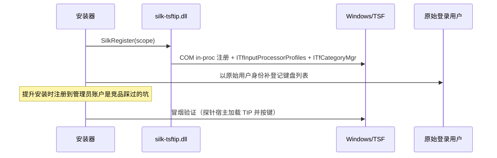

# 07 安装、注册与分发

本文定义安装包形态、注册流程、签名、升级与卸载策略。注册机制的技术细节见 [03](03-windows-platform.md)，文件锁定升级决策见本文"升级"节。

## 分发形态

**Inno Setup 单文件安装包**。

| 备选 | 结论 |
| --- | --- |
| WiX / MSI | 企业 GPO 分发友好，但脚本灵活性差、开发成本高；列为后续渠道增强 |
| MSIX | TIP 注册与文件占用语义不适配，否决 |
| 绿色便携 | 无法注册 TSF，只能做演示模式，不做正式分发 |

## 安装模式

| 模式 | 目标目录 | 权限 | 注册作用域 | 候选窗能力 |
| --- | --- | --- | --- | --- |
| per-user（默认） | `%LOCALAPPDATA%\Programs\Silk` | 无需管理员 | HKCU | 默认路 + host_render 兜底 |
| per-machine（可选） | `%ProgramFiles%\Silk` | 管理员 | HKLM | 可启用 UIAccess（签名 + 清单 + 受信任目录），进程外窗口盖过系统 UI |

普通用户默认路径是产品承诺（竞品"便捷模式"的存在证明需求真实）；完整模式是增强，不是前提。

## 运行库红线

1. **零运行库依赖**：Go 静态链接；Rust `+crt-static`；MSVC 产物静态 CRT（`/MT`）。缺 VC++ 运行库是竞品头号安装故障，安装器不提示装运行库。
2. **不内嵌脚本/插件运行时**（PIME 内嵌运行时的 CVE/RCE 清单是账单）。
3. **模型资产不进主安装包**：本地模型（若启用）是独立的可下载/可校验/可删除资产。

## 注册流程



- 注册幂等：重复安装只补差。
- 补登记必须以**发起安装的用户**执行（而非提升后的管理员令牌）。

## 签名与信任（一等公民）

- **全部产物 Authenticode SHA256 签名**：安装包、`silkhost.exe`、`silk-tsftip.dll`、`silkui.dll`。
- 无签名的代价是真实准入成本：IME 的注入行为与恶意软件特征相似，SmartScreen/杀软误报是竞品共同的已知问题（青简/XSIME 均因未签名列为已知问题）。
- 证书：个人/开源开发者代码签名证书起步（竞品个人证书与 Certum 开源证书先例）；UIAccess 模式对签名有额外要求。
- 发布附校验和；构建可复现性与出处证明列为后续增强。

## 文件布局

```
安装目录\
  silk-tsftip.dll        # TSF 适配（兜底路按需加载 silkui.dll）
  silkhost.exe           # 引擎 + 会话 + UI（经 FFI 加载 silkui.dll）
  silkui.dll             # 渲染库
  dict\                  # 核心词库（只读资产）

%LOCALAPPDATA%\Silk\     # 用户数据（纯文本，卸载默认保留）
  userdict.txt  phrases.txt  silk.toml  logs\
```

## 升级（DLL 锁定问题）

事实：TSF DLL 被加载进所有正在使用输入法的进程，Windows 不允许原地替换被占用文件。竞品代价从"要求重启电脑"（清风）、"重开所有程序"（青简）到宣称免重启（0c）不等。

策略分层：

1. **host / silkui / 词库**：先停 host → 原子替换。总是可行。
2. **silk-tsftip.dll**：对已加载文件执行**改名占位**（Windows 允许 rename 打开中的文件）：旧 DLL 改名为 `*.old` → 新 DLL 落原名。已运行进程继续用旧模块直到退出，新进程即刻用新版——多数场景免重启。
3. 改名失败（个别占用形态）：`MoveFileEx(MOVEFILE_DELAY_UNTIL_REBOOT)` 延迟替换 + 明确提示"重启后完成升级"。
4. 失败回滚：旧文件改名回原位、注册表恢复；用户数据永不参与回滚。

## 卸载

1. `SilkUnregister(scope)` 注销三类注册。
2. 停 host（广播退出），删除程序目录。
3. **默认保留用户数据**（反面教材：竞品卸载删除 `%LOCALAPPDATA%` 整目录含用户词库）；提供显式勾选"同时删除用户词库与配置"。

## 多架构与打包

- x64 与 arm64 双包初版；`ArchitecturesAllowed` 明确声明，不在错误架构上安装。
- Arm64X 单 DLL 合并包为优化项（依赖开放项 O-1，见 03）。

## 分发渠道

- GitHub Releases + 官网（域名自有；细分赛道出现过假官网劫持搜索入口的案例，渠道完整性是安全问题）。
- 提交 winget manifest（开源竞品中仅 Weasel 进入 winget，是低成本高信任渠道）。

## 更新策略

- v1 手动更新：检查更新入口显式、默认不自动下载不自动安装（"默认值即产品立场"）。
- 自动更新留缝：安装布局与静默参数已按更新器可调用设计（`/SILENT /SUPPRESSMSGBOXS`）。

## 需求映射

覆盖 R-1（注册）、R-6（安装升级卸载）、R-12（多架构）、R-13（验证矩阵）。
