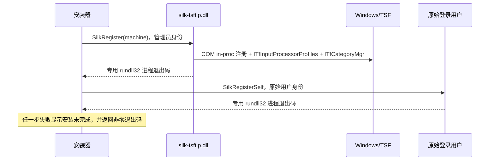

# 07 安装、注册与分发

本文定义安装包形态、注册流程、签名、升级与卸载策略。注册机制的技术细节见 [03](03-windows-platform.md)，文件锁定升级决策见本文"升级"节。

## 分发形态

**Inno Setup 6.7+ 单文件安装包**，使用随编译器提供的简体中文界面。

| 备选 | 结论 |
| --- | --- |
| WiX / MSI | 企业 GPO 分发友好，但脚本灵活性差、开发成本高；列为后续渠道增强 |
| MSIX | TIP 注册与文件占用语义不适配，否决 |
| 绿色便携 | 无法注册 TSF，只能做演示模式，不做正式分发 |

## 安装模式

- 统一管理员安装到 `%ProgramFiles%\Silk`，不再提供 per-user 安装选项。TSF 机器级注册和占用文件的重启删除均需要管理员权限，用户目录安装不能绕过这项约束。
- 以发起安装的原始用户身份启用输入法；建议直接双击安装包，让安装器请求 UAC。若从已提权进程启动，Windows 无法恢复此前的普通用户身份。
- 不沿用历史安装目录。检测到其他目录的机器注册或当前账户的旧用户级安装时，要求先卸载旧版并按提示重启；不得留下两个竞争同一 TIP 注册的卸载器。旧版卸载可保留用户数据。
- Program Files 满足 UIAccess 的目录条件，但 UIAccess 仍要求签名与清单，本安装模式不代表已启用该能力。

## 运行库红线

1. **零运行库依赖**：Go 静态链接；Rust `+crt-static`；MSVC 产物静态 CRT（`/MT`）。缺 VC++ 运行库是竞品头号安装故障，安装器不提示装运行库。
2. **不内嵌脚本/插件运行时**（PIME 内嵌运行时的 CVE/RCE 清单是账单）。
3. **模型资产不进主安装包**：本地模型（若启用）是独立的可下载/可校验/可删除资产。

## 注册流程



- 注册幂等：重复安装只补差。
- 补登记必须以**发起安装的用户**执行（而非提升后的管理员令牌）。
- DLL 注册入口不自行弹窗，安装器统一处理错误；静默模式也必须检查退出码。
- 注册发生在文件事务完成后。注册失败保留程序文件和卸载入口以便修复，不谎称已回滚；也不反向注销可能属于旧版本的机器注册。运行安装包可重试修复。

## 签名与信任（一等公民）

- **全部产物 Authenticode SHA256 签名**：安装包、`silkhost.exe`、`silk-tsftip.dll`、`silkui.dll`。
- 无签名的代价是真实准入成本：IME 的注入行为与恶意软件特征相似，SmartScreen/杀软误报是竞品共同的已知问题（青简/XSIME 均因未签名列为已知问题）。
- 证书：个人/开源开发者代码签名证书起步（竞品个人证书与 Certum 开源证书先例）；UIAccess 模式对签名有额外要求。
- 发布附校验和；构建可复现性与出处证明列为后续增强。

## 文件布局

```
安装目录\
  silk-tsftip.dll        # TSF 适配（兜底路按需加载 silkui.dll）
  silkhost.exe           # 引擎 + 会话 + UI（经 FFI 加载 silkui.dll）
  silkui.dll             # 渲染库
  dict\                  # 核心词库（只读资产）

%LOCALAPPDATA%\Silk\     # 用户数据（纯文本，卸载默认保留）
  userdict.txt  phrases.txt  silk.toml  logs\
```

## 升级（DLL 锁定问题）

事实：TSF DLL 被加载进所有正在使用输入法的进程，Windows 不允许原地替换被占用文件。竞品代价从"要求重启电脑"（清风）、"重开所有程序"（青简）到宣称免重启（0c）不等。

策略优先保证可恢复性，不承诺免重启：

1. `silkhost.exe`、`silk-tsftip.dll`、`silkui.dll` 和核心词库整包替换，避免版本资源差异导致协议两端混装。
2. 安装前提示保存工作、切换输入法并关闭相关应用。交互和静默安装均不自动关闭或强杀应用。
3. 移除手动 `.old` 改名逻辑，由 Inno Setup 文件事务负责替换及文件阶段的失败回滚；占用文件使用 `restartreplace` 登记重启后替换，并由标准完成页提示重启。
4. 提示重启时，必须重启后再使用新版。重启前旧模块可能仍在内存中，不能把此时视为整包升级已生效；已有待重启文件操作时，Inno Setup 会阻止继续覆盖安装。
5. 历史 `silk-tsftip.dll.old` 仅按确切文件名清理；仍占用时登记重启后删除，不扫描未知文件。

## 卸载

1. 用户确认后，先注销当前卸载账户的用户登记，再注销机器级注册。任一步失败立即停止，保留程序文件与卸载入口供修复、重试。
2. 不强杀 host 或加载 TIP 的应用。无占用文件即时删除；程序与词库统一使用 `uninsrestartdelete`，仍被占用时登记重启删除，并显示标准重启提示。关闭窗口不一定卸载进程中的 TIP，最终以重启完成清理。
3. **默认保留用户词库、配置和日志**。程序文件已清除时，交互卸载允许显式确认删除当前卸载账户 `%LOCALAPPDATA%\Silk` 下的数据，默认按钮为“否”；仍有程序占用则保留数据，避免 host 写回导致不完整清理。删除失败明确告知保留位置。
4. 静默卸载始终保留用户数据。提权可能切换账户；卸载器不能使用安装期的 `ExecAsOriginalUser`，不遍历或删除其他账户的数据。其他账户如仍显示历史输入项，可在 Windows 语言设置中移除。

## 多架构与打包

- 当前安装脚本只接受 x64 Windows 10/11（`x64os`），不能把 x64 TIP 当作 ARM64 原生 TIP 分发。
- ARM64 独立包及 Arm64X 合并包尚未落地；工具链约束见 [03](03-windows-platform.md)。

## 分发渠道

- GitHub Releases + 官网（域名自有；细分赛道出现过假官网劫持搜索入口的案例，渠道完整性是安全问题）。
- 提交 winget manifest（开源竞品中仅 Weasel 进入 winget，是低成本高信任渠道）。

## 更新策略

- v1 手动更新：检查更新入口显式、默认不自动下载不自动安装（“默认值即产品立场”）。
- 无人值守安装使用 `/VERYSILENT /SUPPRESSMSGBOXES /NORESTART /LOG="安装日志路径"`；必须检查退出码，注册失败返回 1。不要额外指定 `/RESTARTEXITCODE`：Inno Setup 在需要重启时会优先采用该值，跳过自定义注册失败码。退出码 0 也不代表无需重启，需检查日志中的重启状态；`/NORESTART` 只禁止自动重启。
- 无人值守卸载使用 `/VERYSILENT /SUPPRESSMSGBOXES /NORESTART /LOG="卸载日志路径"`。卸载器不支持安装器的 `/RESTARTEXITCODE`，不可用退出码 0 推断没有待重启删除。
- 安装日志默认开启；反馈卸载问题时用 `/LOG` 显式保存日志，并与执行账户 `%LOCALAPPDATA%\Silk\logs\tsftip.log` 对照。路径可能含账户信息，公开前应脱敏。

## 需求映射

覆盖 R-1（注册）、R-6（安装升级卸载）、R-12（多架构）、R-13（验证矩阵）。
