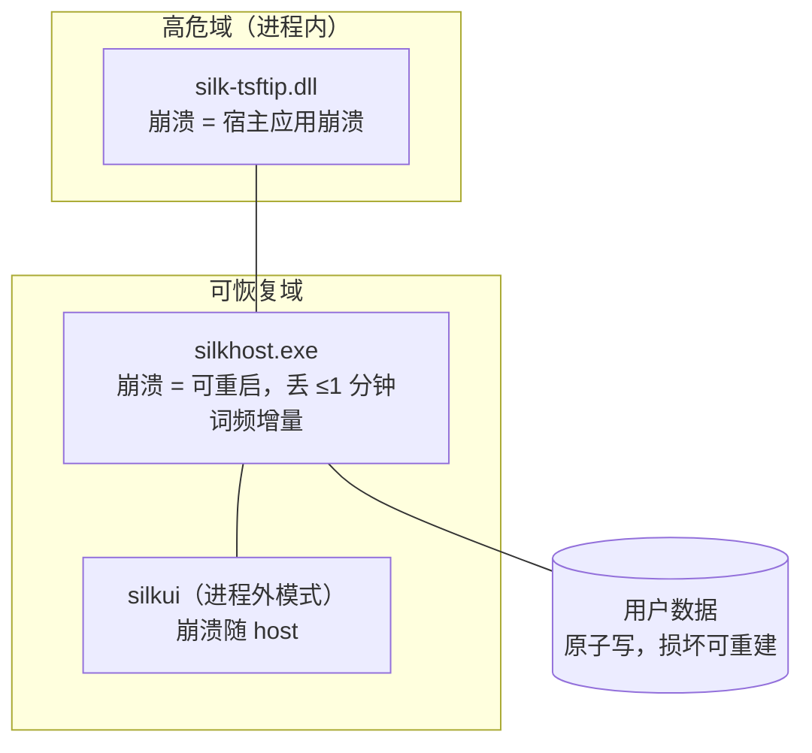

# 08 可靠性、测试与可观测性

本文定义故障模型、降级行为、测试策略与发布质量门。降级的协议细节见 [04](04-process-and-ipc.md)，性能预算见 [05](05-engine.md)。

## 故障域

设计含义：**一切常驻的崩溃复杂度离开 DLL**；唯一进入进程内的图形代码是兜底渲染（`host_render`，受限场景按需加载，见 06）。DLL 内代码以"宁可降级不可异常"为纲（Rust + 禁 panic 策略：可恢复错误全部走降级路径，`panic = abort` 之外不依赖 unwinding）。

## 降级矩阵

| 故障 | 系统行为 | 用户感知 | 恢复 |
| --- | --- | --- | --- |
| host 响应超时（>30 ms） | 按键原样放行，丢弃迟到响应 | 该键为英文直通 | 下一键自动重试 |
| host 崩溃 | 限速重启（≤3 次/分钟），期间纯直通 | 短暂英文输入 | 自动 |
| host 连续失败 | 本进程转纯直通至下次焦点切换 | 退化为英文键盘 | 自动/手动重连 |
| 核心词库校验失败 | 拒载损坏资产，用空词库启动 + 告警日志 | 无候选但可输入 | 修复安装 |
| 用户数据写失败 | 保内存态，下次继续重试 | 无感 | 自动 |
| GPU 重置（驱动恢复） | 重建渲染目标 | 候选窗闪烁一帧 | 自动 |
| 升级时 DLL 占用 | 改名占位 / 延迟替换（07） | 提示"重启完成" | 重启 |
| 畸形协议帧 | 拒绝并断开该连接 | 该宿主直通 | 重连 |

**唯一红线：任何故障不丢按键**（ADR-8）。

## 稳定性回归基准（竞品缺陷清单）

竞品已修复缺陷全部转为回归用例，不重蹈：

- 切换/新建窗口时多线程访问引擎崩溃 → 状态迁移串行化（03）+ 并发测试。
- 托盘/服务卡死 → 基座无托盘；host 有看门式自检（会话队列深度告警）。
- 部分应用不显示输入法 → 宿主兼容矩阵（03）冒烟。
- 显卡重置后绘制失败 → 渲染目标重建用例。
- 全屏高亮/绘制错误 → 全屏场景手测清单。
- 空热键触发配置工具崩溃 → 空输入防御测试。
- 升级后文件被删 → 升级回滚测试（07）。
- 卸载删用户词库 → 卸载保留数据的断言测试。

## 可观测性

| 通道 | 内容 | 隐私约束 |
| --- | --- | --- |
| 运行日志 | 结构化（级别/组件/耗时/错误码），滚动 5×2 MB | **不记录用户文本与候选内容**；仅元数据（按键计数、延迟分位、降级事件） |
| 诊断导出 | 版本、配置快照、日志尾部、注册表状态，人工触发一键导出 | 导出前展示内容清单 |
| 崩溃收集 | shim/host 的 minidump（本地保存，默认不上传） | 无网络路径（基座无任何联网代码） |
| 性能计数 | 热路径分位数（内存环形缓冲） | 仅数值 |

### 运行日志

两端日志同为 logfmt（`key=value` 一行一条），时间为本地毫秒精度，可用同一套 grep 关联：

| | host | shim |
| --- | --- | --- |
| 实现 | `log/slog` TextHandler（`internal/logging`） | `log` 门面 + 自带文件输出（`tsftip/src/logger.rs`） |
| 文件 | `%LOCALAPPDATA%\Silk\logs\silkhost.log`，2 MB × 5 份滚动 | 同目录 `tsftip.log`，所有宿主进程共写，1 MB 滚动保留 1 份 |
| 关联键 | `conn=<连接号> pid=<对端进程>` | `pid= app= tid=` |
| 级别 | `silk.toml` 的 `log_level`，环境变量 `SILK_LOG` 优先 | `SILK_LOG` |

级别约定：`info` 只记生命周期（启动、连接、握手、断开及原因）与异常；`warn` 记降级事件（应答超时放行、编辑会话失败、请求处理超过 10 ms）；`debug` 逐请求/逐键记录类别、id、耗时与结果。shim 同步写文件、不起线程（崩溃前的最后几行最有价值），并装 panic hook 先落日志；host 每条连接带 panic 兜底，单连接崩溃不拖垮进程。

用户文本默认只记字符数；本机排障需要看原文时设 `SILK_LOG_TEXT=1`。

排障示例：`setx SILK_LOG debug` 后重启目标应用（shim 随宿主进程读取环境变量；host 由 shim 拉起时继承），用 `Get-Content -Wait` 跟踪两份日志，按 `pid` 把 shim 一侧的 `id=` 与 host 一侧的 `conn=… id=` 对上。

## 测试金字塔

| 层 | 手段 | 覆盖 |
| --- | --- | --- |
| 引擎单测 | 黄金语料（≥500 条）、确定性重放、rune 流 fuzz、`AllocsPerRun` 门禁 | 分词/查词/排序/上屏语义（05） |
| 协议一致性 | Go/Rust 共享 JSON fixtures 双向编解码断言 + 帧 fuzz | 版本协商、边界、畸形输入（04） |
| 集成 | 自研 mini TSF 测试宿主 + 合成按键流，断言 commit 序列 | shim↔host↔engine 全链路 |
| 宿主兼容 | 手测清单：03 矩阵 + 上方回归基准场景 | Win10/11 × x64/arm64 × 宿主类别 |
| 安装/升级 | 干净 VM 矩阵：per-user/per-machine、升级锁定、卸载保留 | 07 全流程 |
| 性能 | 基准进 CI（退化 >20% 报警）；端到端计时探针 | 05 预算表全项 |

手测清单模板随仓库维护（`docs/testing/`，实现阶段建），每条 = 场景 + 期望 + 通过记录。

## 发布质量门

1. CI 全绿：`go fmt/vet/test/build` + `cargo test/clippy` + 协议 fixtures + 基准不退化。
2. 兼容手测清单签核（目标平台全过或已知问题登记）。
3. 签名校验（`signtool verify` 全产物）。
4. 安装冒烟：干净 VM 安装 → 探针按键 → 卸载 → 用户数据仍在。

## 需求映射

覆盖 R-6（安装验证）、R-7（故障降级）、R-10（可诊断）、R-11（性能验收）、R-13（兼容矩阵）。
