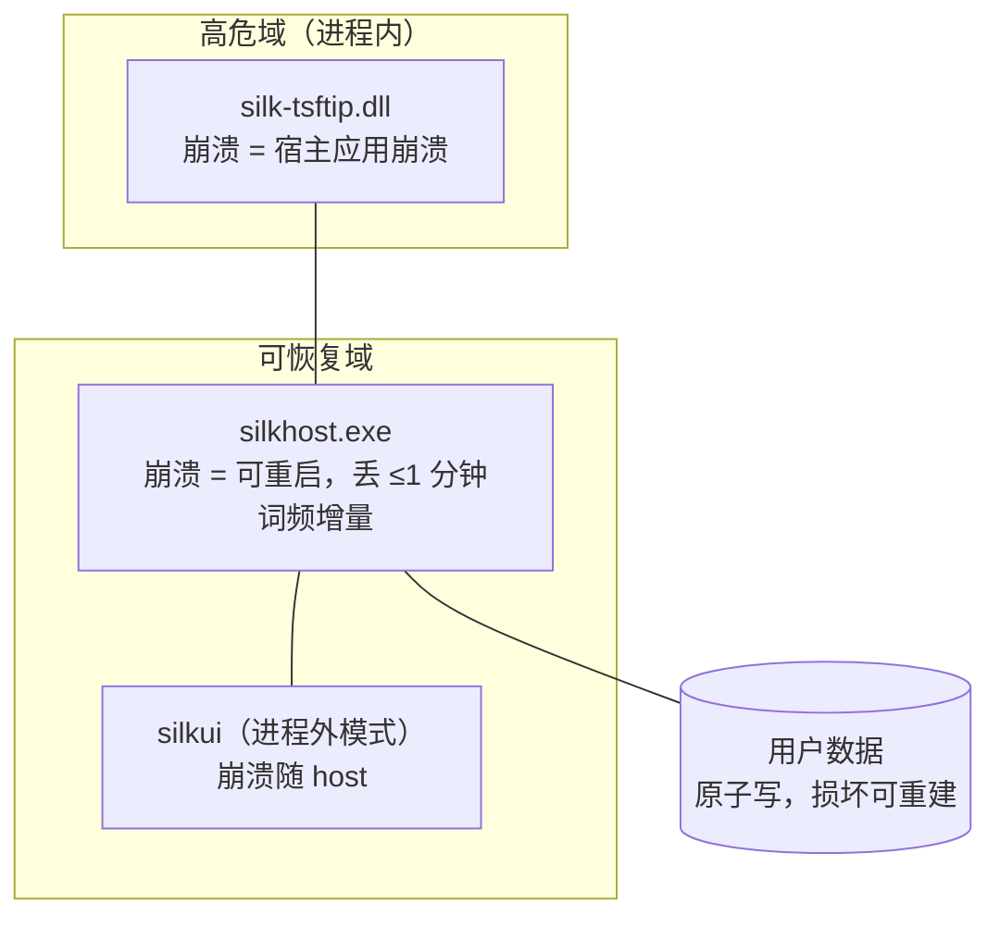

# 08 可靠性、测试与可观测性

本文定义故障模型、降级行为、测试策略与发布质量门。降级的协议细节见 [04](04-process-and-ipc.md)，性能预算见 [05](05-engine.md)。

## 故障域

设计含义：**一切常驻的崩溃复杂度离开 DLL**；唯一进入进程内的图形代码是兜底渲染（`host_render`，受限场景按需加载，见 06）。DLL 内代码以"宁可降级不可异常"为纲（Rust + 禁 panic 策略：可恢复错误全部走降级路径，`panic = abort` 之外不依赖 unwinding）。

## 降级矩阵

| 故障 | 系统行为 | 用户感知 | 恢复 |
| --- | --- | --- | --- |
| host 响应超时（>30 ms） | 按键原样放行，丢弃迟到响应 | 该键为英文直通 | 下一键自动重试 |
| host 崩溃 | 限速重启（≤3 次/分钟），期间纯直通 | 短暂英文输入 | 自动 |
| host 连续失败 | 本进程转纯直通至下次焦点切换 | 退化为英文键盘 | 自动/手动重连 |
| 核心词库校验失败 | 拒载损坏资产，用空词库启动 + 告警日志 | 无候选但可输入 | 修复安装 |
| 用户数据写失败 | 保内存态，下次继续重试 | 无感 | 自动 |
| GPU 重置（驱动恢复） | 重建渲染目标 | 候选窗闪烁一帧 | 自动 |
| 升级时 DLL 占用 | 由安装器登记重启后替换（07） | 提示“重启完成” | 重启 |
| 畸形协议帧 | 拒绝并断开该连接 | 该宿主直通 | 重连 |

**唯一红线：任何故障不丢按键**（ADR-8）。

## 稳定性回归基准（竞品缺陷清单）

竞品已修复缺陷全部转为回归用例，不重蹈：

- 切换/新建窗口时多线程访问引擎崩溃 → 状态迁移串行化（03）+ 并发测试。
- 托盘/服务卡死 → 基座无托盘；host 有看门式自检（会话队列深度告警）。
- 部分应用不显示输入法 → 宿主兼容矩阵（03）冒烟。
- 显卡重置后绘制失败 → 渲染目标重建用例。
- 全屏高亮/绘制错误 → 全屏场景手测清单。
- 空热键触发配置工具崩溃 → 空输入防御测试。
- 升级后文件被删 → 升级回滚测试（07）。
- 卸载删用户词库 → 卸载保留数据的断言测试。

## 可观测性

| 通道 | 内容 | 隐私约束 |
| --- | --- | --- |
| 运行日志 | 结构化 logfmt（级别/组件/耗时/错误码），滚动上限见下表 | 默认不记录输入、候选与上屏原文；仅排障元数据，原文须显式开启 |
| 诊断导出 | 版本、配置快照、日志尾部、注册表状态，人工触发一键导出 | 导出前展示内容清单 |
| 崩溃收集 | shim/host 的 minidump（本地保存，默认不上传） | 无网络路径（基座无任何联网代码） |
| 性能计数 | 热路径分位数（内存环形缓冲） | 仅数值 |

### 运行日志

两端保留 logfmt（`key=value` 一行一条），时间为本地毫秒精度。无需为本地排障改为 JSON；稳定字段、正确转义与请求关联比编码格式更重要。正式构建保留运行时诊断能力，不引入 `trace-keys` 编译开关。

| | host | shim |
| --- | --- | --- |
| 实现 | `log/slog` TextHandler（`internal/logging`） | `log` 门面 + 自带文件输出（`tsftip/src/logger.rs`） |
| 文件 | `%LOCALAPPDATA%\Silk\logs\silkhost.log`，2 MiB × 5 份滚动 | 同目录 `tsftip-<PID>-<启动标识>.log`，每个进程独立写入，最多 1 MiB；满后清空自身文件继续写，优先保留近期诊断 |
| 关联键 | `conn=<连接号> pid=<对端进程>`；请求 `id`、默认脱敏的会话摘要 `sid_sha256` | `pid= app= tid=` 与后台请求采样摘要 |
| 级别 | `silk.toml` 的 `log_level`，环境变量 `SILK_LOG` 优先 | `SILK_LOG` |

消息使用简洁中文，字段名保持稳定。`info` 记录生命周期与关键状态，`warn` 记录可恢复异常与降级，`error` 记录操作失败，`debug` 记录请求类别、关联标识、耗时与结果。TSF 按键回调只累计数值，并通过线程局部屏障阻止同步下层与重入路径格式化日志、取得日志锁或执行文件 I/O；IPC 请求线程也不写日志，由现有连接线程每五秒汇总，日志慢盘不阻塞当前请求通知。不新增常驻日志线程，注册等非热路径保留同步日志。TIP 自己不记录 panic 载荷，但仍调用宿主原有 panic hook，不能约束外部 hook 的行为。

TIP 受管日志固定上限为 **16 MiB、64 个文件、7 天保留期**，不新增容量配置项。创建、回收与追加通过 `tsftip.lock` 的非阻塞跨进程文件锁协调；锁争用或无法腾出容量时丢弃日志，不等待其他进程。只回收名称严格匹配的普通 TIP 日志文件，不删除 host 日志或未知文件；活跃进程持有的日志禁止删除。期限按维护时机清理，活跃文件不强制回收；总量不包括 host 日志、旧版共享日志和固定锁文件。旧版 `tsftip.log` / `tsftip.1.log` 不再写入，可在确认无需排障后手动删除。

host 在现有 `silkhost 启动` 行中一次性记录环境，不另起重复的启动日志，也不在每个 TIP 进程重复采集：

| 字段 | 含义与来源 |
| --- | --- |
| `version`、`pid`、`data_len` | Silk build 版本、host PID、数据目录字符数；仅显式开启敏感诊断时改为 `data` 原路径，本地构建版本可能为 `(devel)` |
| `windows_version`、`windows_build` | `x/sys/windows.RtlGetVersion` 返回的 Windows 内核主/次版本与 build，不依赖应用清单声明；Windows 10/11 都可能为 `10.0`，须结合 build 判断 |
| `process_arch` | `runtime.GOARCH`，当前 host 进程架构 |
| `native_arch` | `IsWow64Process2` 返回的本机架构，例如 `process_arch=amd64 native_arch=arm64` 表示 ARM64 上的 x64 模拟运行 |
| `go_version` | `runtime.Version()`，构建宿主的 Go 版本 |
| `cpu_logical` | `runtime.NumCPU()`，进程启动时可用的逻辑 CPU 数，并非物理核心数 |

本机架构查询失败时省略 `native_arch`，仅附带脱敏后的错误类型与可用的系统错误码；未识别的机器类型保留系统原始数值 `native_machine`，不填入猜测值。环境采集只调用进程内 API，不运行外部命令，不采集机器名、用户名、SID、机器 GUID、序列号或网络地址。启动行遵守日志级别过滤，反馈环境时应保留默认 `info` 或开启 `debug`。

输入、候选、上屏原文及可还原输入的键码序列均属敏感数据，`SILK_LOG=debug` 不解除脱敏。保留通用日志接口，但敏感内容必须经统一入口；错误、panic 以及来自客户端的自由文本同样不能绕过隐私边界。仅本机排障确需原文时显式设置 `SILK_LOG_TEXT=1`，启动时明确告警。路径等必要上下文仍可能包含个人信息，发送反馈前须检查并脱敏；开启过原文日志时也要处理相关滚动备份，排障结束后撤销开关。

host 默认保留错误类型，并从类型化错误中提取系统错误码（`err_errno`）或 JSON 错误类别与偏移（`err_kind`、`err_offset`），不调用任意错误/异常对象的字符串格式化方法；会话标识默认只输出 `sid_sha256`，避免客户端自由文本混入日志。TIP 不记录用户文本，即使开启敏感诊断开关，也只提示其他组件可能记录原文。

TIP 最近请求采样字段为 `sampled=true id elapsed_us result frames`；`elapsed_us` 不含排队时间，`result` 分别为 0 应答、1 超时、2 断连、3 过期、4 host 拒绝。请求 ID 在进程内递增，多个 TIP 实例不会各自重号；摘要只保留最近完整快照，争用时可丢样本，不承诺每个请求都有 TIP 日志。

排障示例：`setx SILK_LOG debug` 后重启目标应用及现有 host（shim 随宿主进程读取环境变量，host 由 shim 拉起时继承；已有进程不会自动刷新）。用 `Get-Content -Wait` 跟踪 host 与故障应用对应的 TIP 文件；按 host 握手行的对端 `pid` 与 TIP 文件的 PID 关联。host 保留逐请求 `id`，TIP 后台摘要提供最近请求采样用于对照，不再保存完整逐键时序；按键计数也不包含原始按键序列。host 启动行的 `pid` 是 host 自身，不能拿它匹配 TIP PID。反馈时附本次启动行与故障前后片段即可；排障后删除临时环境变量并重启相关进程。

## 测试金字塔

| 层 | 手段 | 覆盖 |
| --- | --- | --- |
| 引擎单测 | 黄金语料（≥500 条）、确定性重放、rune 流 fuzz、`AllocsPerRun` 门禁 | 分词/查词/排序/上屏语义（05） |
| 协议一致性 | Go/Rust 共享 JSON fixtures 双向编解码断言 + 帧 fuzz | 版本协商、边界、畸形输入（04） |
| 集成 | 自研 mini TSF 测试宿主 + 合成按键流，断言 commit 序列 | shim↔host↔engine 全链路 |
| 宿主兼容 | 手测清单：03 矩阵 + 上方回归基准场景 | Win10/11 × x64/arm64 × 宿主类别 |
| 安装/升级 | 干净 VM 矩阵：管理员安装到 Program Files、升级锁定、卸载保留 | 07 全流程 |
| 性能 | 基准进 CI（退化 >20% 报警）；端到端计时探针 | 05 预算表全项 |

手测清单模板随仓库维护（`docs/testing/`，实现阶段建），每条 = 场景 + 期望 + 通过记录。

## 发布质量门

1. CI 全绿：`go fmt/vet/test/build` + `cargo test/clippy` + 协议 fixtures + 基准不退化。
2. 兼容手测清单签核（目标平台全过或已知问题登记）。
3. 签名校验（`signtool verify` 全产物）。
4. 安装冒烟：干净 VM 安装 → 探针按键 → 卸载 → 用户数据仍在。

## 需求映射

覆盖 R-6（安装验证）、R-7（故障降级）、R-10（可诊断）、R-11（性能验收）、R-13（兼容矩阵）。
